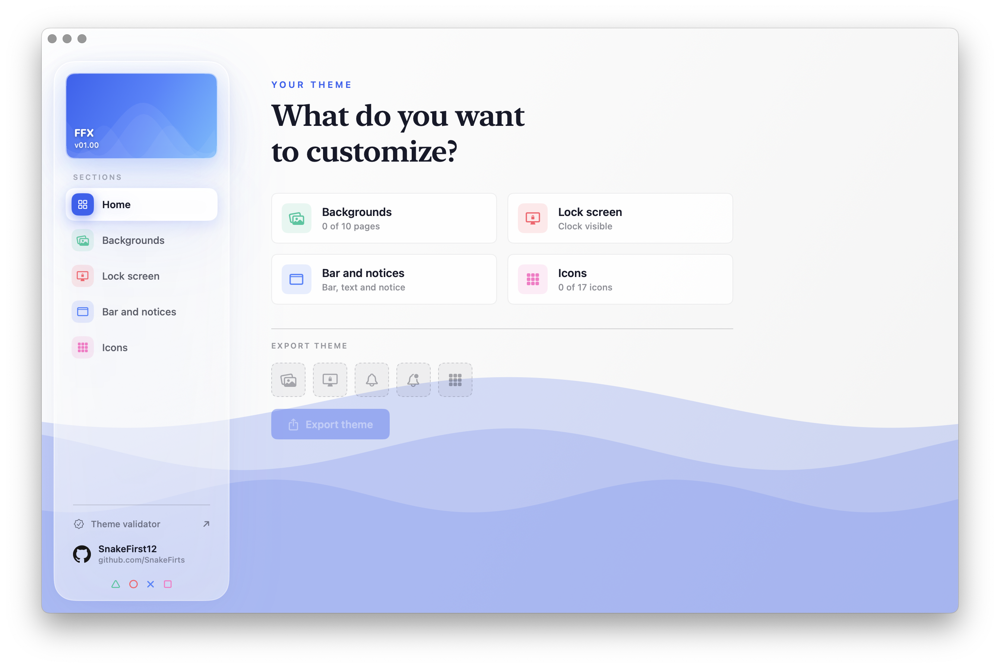
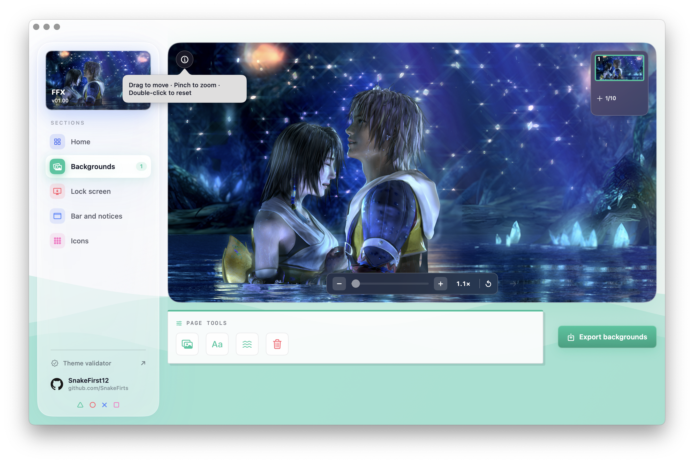
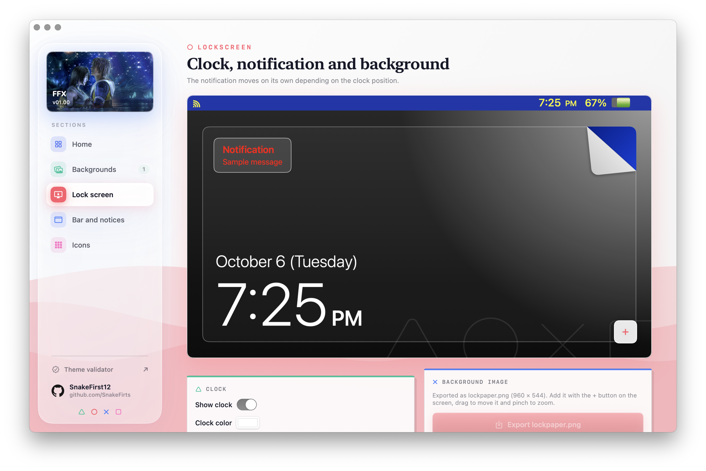
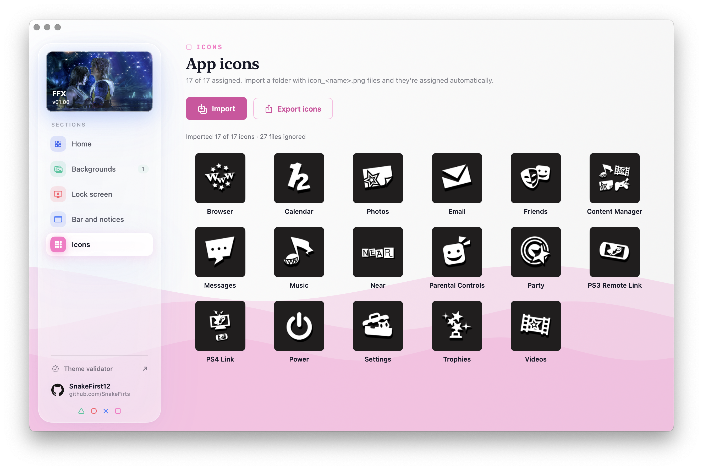

# VitaThemeMaker

A native macOS app to create custom themes for the **PlayStation Vita**.

Pick your images, frame them, choose the colors and export a theme folder (and a ZIP) with
everything the console expects: `theme.xml`, backgrounds, lock screen, icons and notice bubble.

> **v1.00** · macOS 13+ · Apple Silicon and Intel (universal)






## Why

The existing tools for Vita themes are Windows-only and stretch your images whenever they don't
match the console's aspect ratio. VitaThemeMaker fills the screen (cover) by default and lets you
zoom and move the image to frame it exactly how you want.

## Features

- **Backgrounds**: up to 10 pages. Pinch to zoom and drag to frame each one, or import a long
  image as a **panorama** and it is split across pages (horizontal or vertical).
- **Lock screen**: lock screen image, clock position (3 layouts) and clock color, with a live
  preview of the console.
- **Bar and notices**: bar color, text color, notice colors and bubble images.
- **Waves**: all 31 built-in waves (0–30), in the order the console shows them.
- **Icons**: the 17 menu icons. Import a folder of `icon_<name>.png` files and they are
  assigned by name.
- **Export**: writes the theme folder + ZIP and checks it against Sony's limits (image sizes,
  file weight, 8-bit indexed PNGs, file name length, XML size) before you copy it to the console.
- Light and dark mode.

## Install

1. Download `VitaThemeMaker-1.0.dmg` from the [Releases](../../releases) page.
2. Open it and drag **VitaThemeMaker** to **Applications**.
3. First launch: the app is signed ad-hoc (not notarized by Apple), so macOS will warn about it.
   **Right-click the app → Open → Open**. If macOS still refuses, run:

   ```sh
   xattr -dr com.apple.quarantine /Applications/VitaThemeMaker.app
   ```

## Using your theme

1. Export from the app and (optionally) run **Check** to review the limits.
2. Optionally upload the ZIP to the [online validator](https://psvt.ovh/validator/index.php)
   (it accepts ZIPs under 30 MB).
3. Install the theme on your Vita with a custom theme installer such as
   [Custom Themes Manager](https://www.redsquirrel87.altervista.org/doku.php/custom-themes-manager).

> Custom themes require a modified console. You do this at your own risk.

## Build from source

Requires macOS 13+ and Swift 5.9+.

```sh
swift build -c release
swift run VitaThemeMaker
swift run vitaframe
swift test
```

### Package the .app and .dmg

```sh
./scripts/package.sh
```

Produces `dist/VitaThemeMaker.app` (universal, ad-hoc signed) and `dist/VitaThemeMaker-1.0.dmg`.
Change `VERSION` at the top of the script to release another version.

## Command line

The same engine is available as a CLI, `vitaframe`:

```sh
vitaframe <image> <out-dir> [page] [zoom] [focusX] [focusY]
vitaframe panorama <image> <out-dir> [pages|auto] [zoom] [focusX] [focusY] [--horizontal|--vertical]
vitaframe icon <image> <out-dir> <name> [zoom] [focusX] [focusY]
vitaframe previewThumbnail|previewPage|previewLockscreen <image> <out-dir> [zoom] [focusX] [focusY]
vitaframe check <theme-folder>
```

## Project layout

```
Sources/
  VitaThemeKit/     theme model, XML, framing math, image rendering, palette quantizer, validator rules
  VitaThemeMaker/   SwiftUI app
  vitaframe/        command line tool
Tests/              unit tests for VitaThemeKit
scripts/            packaging script (.app + .dmg)
```

## Credits

- [Sony-ThemeTool](https://github.com/LiEnby/Sony-ThemeTool) by LiEnby: the validation rules and the
  wave table were taken from its source.
- [ThemeBUILDER](https://github.com/AntHJ) by AntHJ: reference for the `theme.xml` structure and
  the look of the waves.
- Brand logos in the about panel are from [Simple Icons](https://simpleicons.org) (CC0). The logos
  belong to their respective owners.

## Disclaimer

VitaThemeMaker is an independent, unofficial project. It is not affiliated with, endorsed by or
sponsored by Sony Interactive Entertainment. "PlayStation", "PS Vita" and related names and
logos are trademarks of Sony Interactive Entertainment Inc.

## Author

Made by [SnakeFirts](https://github.com/SnakeFirts).

## License

[MIT](LICENSE) © 2026 SnakeFirts